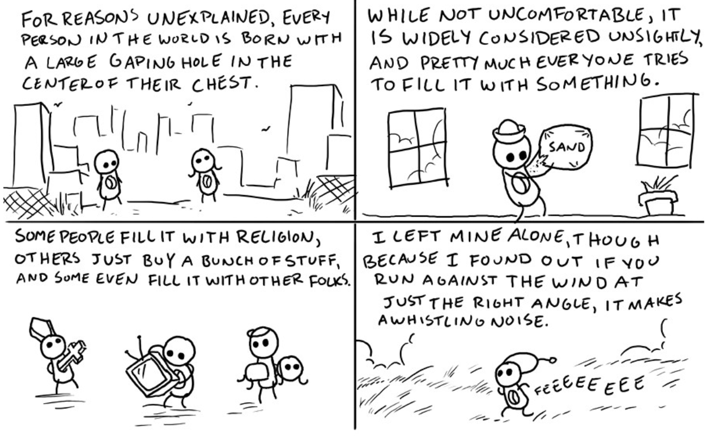

A small motorboat passes, mostly adults. I wave back at them, and a man shouts at me: "see you tomorrow," and some other inaudible quips. I smile and wave again. What the hell did that mean? They pass, and the next boat sports a brunette figurehead standing one-knee-up on the bow. In the back is her college pimp, a poppy stereo, and a second bikini woman, this one blonde. The pimp stares in my direction. I think about our apparent social ranks, and realize that I am on a platform, while he is not. There he goes.

The two kayaks in the distance look like little eyes, and I stare at them until they disappear behind the marsh grass. Why are you going so far, Mom and Daniel? Will you make it back in time? I worry that the night may begin early. A distant cloudbank occupies the horizon, roughly maybe a half-hour of potential sunset. The 98.11% DEET bug spray on my left leg sparkles a warm gold like the water below. Oh, a turtle.

I decide it's fine; this is Daniel's prerogative. I've been ready for years. I take a piss while they're out of sight then reseat myself in my collapsable plastic throne. A boy fishing on the dock to my left shouts snickering imitations of erotic moans to another on the balcony of the five-floor mansion behind us. Maybe I should ask him to stop; no, he's just a kid. Are kids at fault for making obnoxious, whiny sex noises? I never did anything like that. I had good parents. Like Dad.

Mom and Daniel finally reappear. I wonder how much of Dad is left in the urn in the bag in the kayak. I guess it's either less than half or more than half (very observant, Adam). Daniel docks. He hands me the bag; I say "thanks," and he gets out of the boat. It didn't really make sense to say, but I felt like I had to say something. I hop in, take the bag back, and paddle out to meet Mom.

I don't try to be sad, and I'm not very. My feng-shui instincts that helped me make that drawing with the squares at age 8 kick in, and I pull off to the left at the first major fork. I don't see the need to go so far away. The urn unscrews easily and I ask mom if she wants to pour any. She chokes back some tears and says no, it's okay, "I'm here. I'm a part of this."

Hm. The bag is not pull-outable. I guess I can leave it in the urn? Feels a little silly.

Dad's ashes – what was once his flesh – sinks to the bottom. I'm glad, I was afraid it might float. Clouds of gray fill the water around my kayak. It feels healthy. The bag comes out. Mom suggests I rinse out the bag and the urn – good, I had been wondering if she'd be okay with that.

During my drive down, I listened to Kendrick Llamar's "United in Grief". "I grieve different," he says. Writing this, I wonder if I do. If Daniel does. If Daniel would leave if I played the song. If it was appropriate to play "We Cry Together" while Dad's ashes sat in the passenger's seat. Heh.

This urn is difficult to clean. Is that his dust? Rust? Oh gosh, a little metal spike from the weld job on the inside. That's probably why there are ashes in the bottom. Mom says this was his favorite place in the whole world, and that's why he wanted us to do this here. I didn't know that. It's not the most pleasing place. There are flies, the seagulls scream at you, the muck smells, and the grass cuts your feet and legs. But still, I understand, maybe I agree. His ashes will probably fertilize the plants here. Actually, I don't know, I don't know how plants work. I tell mom all of this.

As I hold the urn, I realize it makes a deep whistling noise in the wind. I show mom, and I relay one of my favorite thoughts regarding holes, wind, and humans (no, it's nothing dirty). She is still sad, but bemused, and I regret I learned this beautiful lesson via a long-lost 4koma from the author of the now-mediocre webcomic *Dresden Kodak*:

The wetlands are alive. On par with rainforests and reefs, but murkier, more primal. Credit to Senna Diaz.

Over dinner, I try to read "Zap-O-Rama," and Daniel leaves the room after the first paragraph. Mom called him back in, we finished eating, and I didn't read the rest.

I don't know why he didn't want to hear it.

Was it the fact that *I* was reading it?

The events of the day?

That it revealed a side of Dad that made him uncomfortable?

Or something entirely different?
